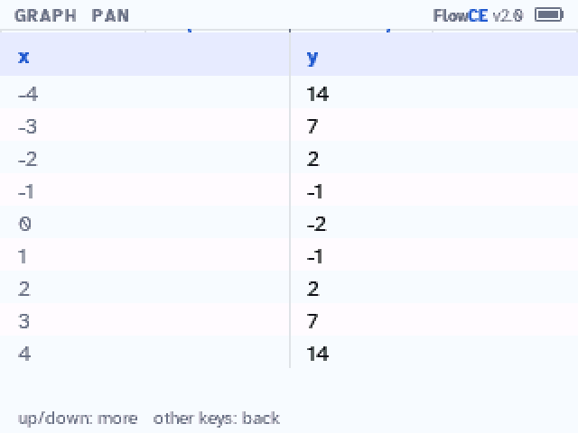
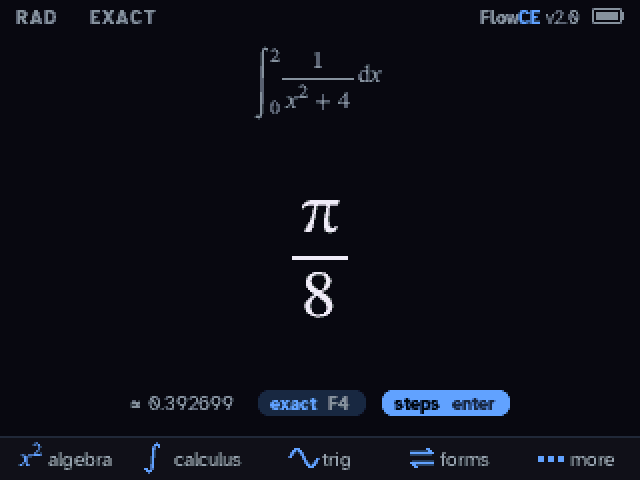

<h1 align="center">FlowCE</h1>

  <b>Calculus on your TI-84 Plus CE.</b> 
  Type math the way it looks. Get answers the way your textbook writes them, and now the steps.

  
  
  
  

  
  

FlowCE is a computer algebra system for the TI-84 Plus CE, built for Calc 1 and Calc 2. It gives
exact answers: `π²/6`, not `1.64493`; `ln|sec x + tan x| + C`; `(2n²+3n+1)/(6n²)`. The decimal value
sits right under the exact one. The interface is new from top to bottom: a clean light or dark
look, math drawn as you type it, and keys that work the way a TI user expects.

**[Install it from the FlowCE page](https://tommyb3ll.github.io/FlowCE/)**: plug in the calculator,
pick a version, click Install, and follow the short calculator prompts.

## Two versions

| | **FlowCE** 2.0 | **FlowCE Python** 1.9.1 |
|---|---|---|
| Step-by-step solutions | calculus (derivatives, integrals, limits, sums, Taylor series) and algebra (equations, factoring, systems, inequalities) | |
| Graphs | a graph screen: exact key points, pan and zoom, circles, polar, slope fields | the classic graph, trace, table |
| Applications menu | area, volumes, arc length, surface area, average value | |
| Statistics and probability | data, regressions, distributions, tests | |
| Programs (Python syntax, the program editor) | | yes |
| Download | [`FlowCE.b84`](https://github.com/tommyb3ll/FlowCE/releases/latest/download/FlowCE.b84) | [`FlowCE-python.b84`](https://github.com/tommyb3ll/FlowCE/releases/latest/download/FlowCE-python.b84) |

FlowCE is the one for class; FlowCE Python is for writing programs. Both have the shared features
below. Install one at a time.

## Steps

After an answer, press `enter`: FlowCE shows how to get it, the way a worked example in a textbook
does. Derivatives, integrals, limits, sums and Taylor series, and in algebra linear and quadratic
equations (by the formula), factoring, rational and radical equations, systems, exponential, log
and trig equations, inequalities, absolute values and polynomial division. Each step says what it
does and the rule it uses (integration by parts, the chain rule, L'Hôpital's rule, the
quadratic formula, elimination...); a part worked out on the side gets its own steps. `▲` and
`▼` move from step to step.

| | | |
|:-:|:-:|:-:|
|  |  |  |
| integration by parts | a quadratic, by the formula | a limit, L'Hôpital's rule |
|  |  |  |
| a system, by elimination | a sum, partial fractions | an inequality |

**Calculus → Applications** (the `0` key on the calculus menu): area between curves, volumes by
washers or shells, arc length, surface area and average value, each in a form that asks for its
curves and bounds in words, with worked steps. Under each answer, `▶` offers what to do next: factor, solve = 0, graph, the derivative...

| | | |
|:-:|:-:|:-:|
|  |  |  |
| Calculus → Applications: a form | find crossings, then the area | `▶`: what to do next |
|  |  |  |
| the graph screen, key points | `analyze(f)` | statistics: a fitted line |

The algebra steps, the graph screen, `analyze`, statistics, probability and practice come from
[DeltaCE](https://github.com/bupfff/DeltaCE), a fork of FlowCE by Gabriel, merged back into FlowCE.

Not every problem has steps yet: when no textbook method explains the answer, it says so. If a step
looks wrong, please [open an issue](https://github.com/tommyb3ll/FlowCE/issues/new/choose) with
what you typed, or post on the [Cemetech thread](https://www.cemetech.net/forum/viewtopic.php?t=21437).

## Highlights

- **Type math as it looks.** Fractions, powers, roots, integrals, sums, limits and derivatives are
  drawn in 2D while you type. `/` makes a fraction of what is before it, `^` opens an exponent,
  and the arrows move through the boxes in the order you read them. Commands from the menus and
  the search come with a box for each argument, labeled with what goes in it, and a line under
  the input says what the command does, with an example.
- **Answers like your textbook.** `arctan((x+1)/2)`, `x − x³/6 + x⁵/120 + O(x⁶)`,
  `C1·cos(x) + C2·sin(x)`, polynomials in descending powers, `log` meaning base 10, `+ C` on
  antiderivatives. Press **F4** for other forms: simplified, one fraction, factored, expanded,
  decimal. To keep answers exactly as computed, turn off *Simplify answers* in `mode`.
- **Calculus 1, 2 and 3.** Derivatives, integrals (trig integrals, trig substitution, partial
  fractions, arc length and surface area), improper integrals that say *diverges* when they do,
  limits that say *does not exist* (with the left and right values), series and power series
  sums, Taylor series, Riemann sums, differential equations with initial values, parametric and
  polar areas, gradients, multiple integrals, complex numbers, vectors, matrices.
- **Keys that work like a TI's.** `(-)` is a minus sign and `2nd (-)` is **Ans**. Starting a line
  with `×`, `÷`, `+`, `−` or `^` works on the last answer (`× 2 enter` doubles it). `2nd enter`
  brings back your last input, and `sto→` stores (`5 → b`).
- **Graphs.** Graph the line you typed, or the last answer, in one step. Trace along the curve,
  zoom, find roots and extrema, and see a table of values.
- **History and search.** **▲** walks through your past calculations; enter reuses an input or an
  answer. **▼** searches every command, with descriptions and examples.
- **Nine themes** (*more* → Themes): Paper, Night, Sand, Mint, Arctic, Ember, Rose, Grape and Forest,
  each shown on the whole screen as you move to it.
- **Tested on the calculator itself.** Before a release, about 900 Calc 1–3 problems run on an
  emulated TI-84 Plus CE and their answers are checked against a computer's. A long calculation
  shows *Calculating*, and **ON** stops it; one that runs out of memory stops with a message
  instead of closing the app.

## Screenshots

| | | |
|:-:|:-:|:-:|
|  |  |  |
| an antiderivative, with `+ C` | typing a definite integral | Σ 1/n² = π²/6 |
|  |  |  |
| a power series: −ln(1−x) | a limit that does not exist | a Riemann sum, index i |
|  |  |  |
| ∫ sec³x | a trig substitution | an initial value problem |
|  |  |  |
| F4: other forms | trace along a graph | a table of values |
|  |  |  |
| history | command search | Night theme |

## Install

**[The FlowCE page](https://tommyb3ll.github.io/FlowCE/#install) selects the installer for your OS.** Open it in Chrome
or Edge with the calculator plugged in, pick FlowCE or FlowCE Python, and click Install: it checks
the calculator, erases its archive (after you agree), sends FlowCE and opens the installer. Press
`enter` once on the calculator: it installs and restarts by itself. On Windows it needs
[TI Connect CE](https://education.ti.com/en/products/computer-software/ti-connect-ce-sw) 6.1 or
newer installed (for its USB driver).

**OS 5.8.5:** the page selects **arTIfiCE v3** and guides you through Inequalz, **AsmHook2**,
then **INST**. The page supplies and transfers all required files; there is nothing to download
or select yourself. It prepares RAM and starts INST automatically, with two short calculator prompts in between.
[TI Connect CE instructions](docs/install/os-5.8.5.md) are also available.
OS **5.8.4.0058** still uses v2.1. The one-enter automatic finish above applies to the v2.1 path.
Keep your current OS; upgrading is not necessary to use FlowCE.

You need a **TI-84 Plus CE** (or TI-83 Premium CE). FlowCE fills most of the
memory (about 2.8 MB), so installing it erases the calculator's apps and archived files: back up
anything you want to keep first. FlowCE is a computer algebra system: follow your class and test
rules (some tests, like the ACT, don't allow one).

**OS 5.3–5.8.4 by hand, with TI Connect CE:**

1. **Clear the memory:** `2nd` `+` (MEM) → `7:Reset...` → right arrow twice to **ALL** →
   `1:All Memory...` → `2:Reset`.
2. **Send the bundle:** download [`FlowCE.b84`](https://github.com/tommyb3ll/FlowCE/releases/latest/download/FlowCE.b84)
   or [`FlowCE-python.b84`](https://github.com/tommyb3ll/FlowCE/releases/latest/download/FlowCE-python.b84),
   drag it onto the calculator in TI Connect CE and send it.
3. **Run the installer:** `prgm` → `enter` → `enter` opens the arTIfiCE shell; `enter` starts
   INST and `enter` again installs. It counts down to 0; don't touch the calculator.
4. At *"Success! Will now reset"*, press `enter` (a few times if the screen looks odd).
5. **Start:** `clear`, then `apps` → **FlowCE**.

| 1. Clear the memory | 3. Run the installer | 5. Start FlowCE |
|:-:|:-:|:-:|
|  |  |  |

**If something goes wrong**
- *The screen freezes at "Success! Will now reset":* press the reset button on the back of the
  calculator (a pen tip or a paperclip). FlowCE stays installed.
- *The calculator acts strangely* (menus glitch, TI Connect CE stays on "refreshing"): clear the
  RAM: `2nd` `+` (MEM) → `7:Reset...` → `1:All RAM...` → `2:Reset`. This does not remove FlowCE.
- *The calculator stays unresponsive:* hold the reset button for a few seconds.

## Keys

| Key | What it does |
|---|---|
| F1 to F5 | menus: algebra, calculus, trig, symbols, more (with `2nd` or `alpha`: more menus) |
| F1 / F2 action after typing | applies to what you typed: `x^2−1` then Factor is `factor(x^2−1)` (on an empty line: the last answer) |
| `enter` after an answer | its steps (calculus, equations, inequalities, factoring, divisions) |
| `▶` after an answer | the row of next steps: `◀` `▶` move, `enter` does it |
| F4 on the steps page | another method, when there is one (long or synthetic division) |
| `math` | templates: fraction, root, integrals, derivative, limit, sum |
| ▲ / ▼ | history / search every command |
| F4 on an answer | its other forms (on an antiderivative, its derivative as a check) |
| `(-)` | a minus sign; `2nd (-)` is the last answer (Ans) |
| `+` `−` `×` `÷` `^` `x²` first | works on the last answer, as on a TI (`× 2` is Ans·2) |
| `2nd enter` | the last input again (ENTRY); press again for the one before |
| `sto→` | stores a value: `5 → b` |
| `clear` | erases the line; on an empty line, the answer |
| ON or `clear` while computing | stops the calculation |
| *more* → Graph | graphs the line or the answer; in the graph: F2 window and curve study, `2nd graph` table (FlowCE 2.0: arrows pan, `+` `−` zoom, F1 trace, F3 key points and tools, F4 table) |
| *more* → Statistics, Probability, Practice | data and fitted curves, distributions and tests, practice problems (FlowCE 2.0) |
| `mode` | settings (*Simplify answers* on or off), shortcuts, about |
| `2nd quit` | quit (your session is kept) |

## Building

FlowCE builds with the [CE C/C++ toolchain](https://github.com/CE-Programming/toolchain) (CEdev
v14.2) plus `g++` and `python3`. Clone with `--recursive` (the engine is the `src/giac`
submodule). `./mkappen` builds the English app: AppIns appvars (`.8xv`) installed by the INST
program, and `FlowCE.b84` for TI Connect CE. After `make clean`, `STEPS=1 ./mkappen` builds FlowCE
Steps (step-by-step solutions instead of Python syntax), and `UNITS=1 ./mkappen` builds physical
units instead of Python syntax. The step-by-step code is on the `dev/ux-speed` branch; `main` is
the 1.9 release. `tools/dev/build.sh` builds in WSL from the working tree, `tools/emu/` drives the
CEmu emulator for regression tests, screenshots and the GIFs above, and `tests/host/` holds host
tests of the editor and the 2D layout.

The app must fit in 43 flash pages (at most 2,818,045 bytes); the build prints the room left.

## Credits and license

FlowCE, by Tommy Bell, is a fork of [KhiCAS](https://www-fourier.univ-grenoble-alpes.fr/~parisse/)
by Bernard Parisse.

- **Math engine:** Giac, by Bernard Parisse and contributors (Institut Fourier, Université
  Grenoble Alpes).
- **Algebra steps, the graph screen, analyze, statistics, probability and practice** (FlowCE
  2.0): from [DeltaCE](https://github.com/bupfff/DeltaCE), a fork of FlowCE by
  Gabriel, merged back into FlowCE with its history.
- **Console interface:** adapted from Eigenmath for the Casio Prizm by G. Maia, Mike Smith,
  Nemhardy and LePhenixNoir.
- **Thanks** to Adrien Bertrand, Xavier Andreani and the TI-83/84 development community,
  especially Jacob Young, commandblockguy and Matt Waltz.
- **Installer:** [arTIfiCE](https://yvantt.github.io/arTIfiCE/) by YvanTT.
- **Fonts:** Atkinson Hyperlegible (Braille Institute) and STIX Two, under the SIL Open Font
  License (`tools/fonts/src`).

FlowCE is free software under the [GNU General Public License](LICENSE), version 3 or later. It
comes with no warranty.
